# Architecture audit

Research date: 2026-11-11. Audited checkout: `c7278c4b514182efc91dad95413391dbde922de2`.
Paths and line numbers refer to this checkout, relative to the Git root `nextjs-observe/`.
Evidence links use GitHub-style line anchors; line numbers are also written in the text for local readers.
This is research only. Proposed modules elsewhere in this directory do not exist yet.

## Scope and product boundaries

The supplied workspace directory `observer/` is a container of checkouts, not the Git root. All subsequent repository research and documentation writes were performed from `observer/nextjs-observe/`. The root contains `packages/`, `spikes/`, and `docs/`; there is no root package.json, pnpm workspace, or application directory. The two publishable packages have independent npm manifests, lockfiles, tests, and builds. The only application inside this monorepo is the nested Observer SPA. Sibling `workshop-ai-observability`, `vercel-otel-test`, `workshop-slides`, and `lovable_result` are outside this Git tree; they are not hidden packages of this product. See the [root README](../../../README.md) and [working layout](../../../CLAUDE.md).

**Observe** is instrumentation and export. **Observer** is telemetry visualization and analysis. Physical packaging currently bundles the frontend, receiver, backend analysis, and storage in `next-observer`; these are separate architectural responsibilities. The receiver is the custom Node HTTP service in `src/collector/server.ts`, and storage is `MemoryStorage`. Neither is implemented by the SPA. There is no separate upstream OpenTelemetry Collector daemon or database in the audited pipeline ([collector exports, lines 1–8](../../../packages/next-observer/src/collector/index.ts#L1), [CLI wiring, lines 285–325](../../../packages/next-observer/src/cli.ts#L285)).

## Package inventory

| Actual package | API / purpose | Dependencies and compatibility | Limits |
|---|---|---|---|
| `next-observe` 0.4.0 | Public subpaths `/config`, `/server`, `/client`, `/runtime`, `/loader`, `/proxy`; `withObserve`, `register`, `registerClient`, `__observe.run`, loader and route `POST` | OTel API peer; OTel SDK/exporter/instrumentation, Vercel OTel, Babel. Next >=16 peer; Node >=22.18 engine. Server/Edge, browser entrypoints have different requirements | No published root API, generic web bootstrap, or RN entrypoint. Package-wide Next peer remains even if a reusable subpath is imported |
| `next-observer` 0.3.35 | CLI `next-observer` / `nxo`; `/collector`, `/debug`, `/agents` exports. HTTP ingest/query/static service, analysis, checks, AI investigations | Node >=22.18; ADK, GenAI, Kitana, Zod runtime dependencies. OTel dependencies are development dependencies, not the receiver implementation. No dependency on `next-observe` | Node backend cannot run in browser/RN; bounded volatile span store; trace-only receiver |
| `next-observe-ui` 0.0.0, private | Observer SPA nested under `packages/next-observer/ui`; no library public API | React 19.3, React DOM, TanStack Query/Router, Radix/shadcn, Vite/Tailwind; uses backend type imports and some pure backend helpers | Browser UI, not instrumentation; no RN renderer; built into parent distribution |
| `adk-kitana-spike` 1.0.0, private | `spikes/adk-kitana`: scripts `agent`, `orchestrator` | ADK/Kitana/GenAI/Zod; Node experiments | AI tool protocol exploration; no OTLP storage or runtime instrumentation role |

Manifest evidence: [Observe](../../../packages/next-observe/package.json), [backend](../../../packages/next-observer/package.json), [UI](../../../packages/next-observer/ui/package.json), [spike](../../../spikes/adk-kitana/package.json). See [OTel version audit](OTEL_COMPATIBILITY.md#versions).

## Dependency and deployment diagram

```mermaid
flowchart LR
  NC["Next build config\nnext-observe/src/config.ts"] --> BT["Babel directive transform\nsrc/transform/plugin.ts"]
  BT --> RT["Observe runtime\nsrc/runtime.ts"]
  RT --> API["OpenTelemetry API"]
  SV["Observe server register\nsrc/server.ts"] --> VS["@vercel/otel + batch processors"]
  CL["Observe browser register\nsrc/client.ts"] --> WS["WebTracerProvider + batch processor"]
  API --> VS
  API --> WS
  WS --> PX["Next rewrite / optional proxy\nconfig.ts / proxy.ts"]
  VS --> OTLP["OTLP/HTTP traces"]
  PX --> OTLP
  EX["Other runtimes' OTel SDKs\nnot implemented in this repo"] -.-> OTLP
  subgraph PKG["Physical package: next-observer"]
    OTLP --> RX["Node receiver\nsrc/collector/server.ts"]
    RX --> DEC["protobuf.ts → decode.ts\nor JSON → decode.ts"]
    DEC --> MEM["MemoryStorage\nsrc/collector/memory-storage.ts"]
    MEM --> Q["Query / aggregation API\nserver.ts, operation.ts, overview.ts"]
    Q --> UI["Observer SPA\nui/src/pages + ui/src/api.ts"]
    MEM --> DA["Debug queries / detector\nsrc/debug"]
    DA --> AI["AI investigations\nsrc/agents"]
    AI --> Q
  end
```

The OTel wire boundary already decouples the two publishable packages. Preserve it. Native collection belongs in the target app/Observe adapter; Observer receives descriptions of measured work. Adding framework tracks requires no React dependency in the receiver.

## Pipeline by stage

1. **Instrumentation.** `withObserve` adds a Turbopack loader rule and proxy rewrite ([config.ts:80](../../../packages/next-observe/src/config.ts#L80)). The directive plugin wraps selected functions and classifies uppercase names as components ([plugin.ts:99](../../../packages/next-observe/src/transform/plugin.ts#L99)); this is a naming heuristic, not reconciliation instrumentation. Runtime records exceptions/status, handles thenables and creates active spans for ordinary functions/server components ([runtime.ts:37](../../../packages/next-observe/src/runtime.ts#L37)). Browser component calls become a five-second `react.renders` aggregate span with dynamic attributes, not a render timeline ([runtime.ts:9](../../../packages/next-observe/src/runtime.ts#L9)).
2. **SDK.** Server registration delegates to `@vercel/otel` and attaches service instance/version ([server.ts:66](../../../packages/next-observe/src/server.ts#L66)). Browser registration installs document-load, fetch, XHR and browser-error capture ([client.ts:57](../../../packages/next-observe/src/client.ts#L57), [browser-errors.ts:79](../../../packages/next-observe/src/browser-errors.ts#L79)).
3. **Export.** Server sends JSON/protobuf to one or more destinations, drops known dev npm noise and batches at 1s in development / 5s otherwise ([server.ts:25](../../../packages/next-observe/src/server.ts#L25), [exporter-config.ts:76](../../../packages/next-observe/src/exporter-config.ts#L76)). Browser uses JSON HTTP exporter, 2s batching, visibility/pagehide flush. Optional Next proxy forwards only traces, buffers up to 5 MiB, hides destination credentials, returns primary destination response ([proxy.ts:7](../../../packages/next-observe/src/proxy.ts#L7)).
4. **Receive.** `startCollector` defaults to loopback:4318, handles POST `/v1/traces`, accepts JSON or protobuf plus gzip, limits compressed and decompressed bodies to 10 MiB; optional x-api-key ([server.ts:152](../../../packages/next-observer/src/collector/server.ts#L152), [listen:438](../../../packages/next-observer/src/collector/server.ts#L438)).
5. **Decode/process.** Custom protobuf reader produces JSON-like traces; normalizer extracts spans, attributes/resources/events, converts times. After insert, cold-start/check spans are excluded from detector input ([ingest:175](../../../packages/next-observer/src/collector/server.ts#L175), [decode.ts:59](../../../packages/next-observer/src/collector/decode.ts#L59)). Next-specific interpretation is in [framework.ts](../../../packages/next-observer/src/collector/framework.ts), [span-label.ts](../../../packages/next-observer/src/collector/span-label.ts), cold-start rules and overview request selection. General ingest is not restricted to Next spans.
6. **Storage.** `StorageAdapter` is a public async interface, currently span-only ([types.ts:119](../../../packages/next-observer/src/collector/types.ts#L119)); only implementation is `MemoryStorage` with append array and by-trace map ([memory-storage.ts:55](../../../packages/next-observer/src/collector/memory-storage.ts#L55)).
7. **Query.** HTTP APIs provide traces, services, operations, overview, defects, regression; debug queries provide version comparison. Receiver route dispatch is authoritative ([server.ts:315](../../../packages/next-observer/src/collector/server.ts#L315)).
8. **Visualization.** Browser fetch helpers import backend types ([api.ts:1](../../../packages/next-observer/ui/src/api.ts#L1)); trace waterfall/detail, operation histogram, dashboard, errors/checks/chat pages consume those queries. Static assets are served by backend [static.ts](../../../packages/next-observer/src/collector/static.ts); [Vite config](../../../packages/next-observer/ui/vite.config.ts) builds `../dist/ui`.

## Data preservation

[NormalizedSpan, types.ts:14](../../../packages/next-observer/src/collector/types.ts#L14) contains IDs/parent/name/kind, service/version, scope name, start/duration, status/message, attributes/resource/events. Events retain name/time/attributes. There is **no span link type**, scope version/attributes, schema URL, trace state, flags, dropped counts, or raw envelope. Int64 attributes become Number; bytes become base64 strings without a retained OTLP value tag. Start/event nanoseconds truncate to microseconds then epoch Number milliseconds; durations are subtracted with BigInt first and converted to Number milliseconds ([decode.ts:40–84](../../../packages/next-observer/src/collector/decode.ts#L40)). Therefore this is a useful normalized view, not a lossless OTLP archive. See [compatibility](OTEL_COMPATIBILITY.md).

## UI audit

| Capability | Actual status and source |
|---|---|
| Nested spans and timeline | Depth-first rows with offsets/widths; missing parent becomes root ([waterfall.ts:29](../../../packages/next-observer/ui/src/lib/waterfall.ts#L29)) |
| Attributes and events | Attribute details and event names/attributes; events are not timestamp markers; resources/scope have no full inspector ([trace-page.ts:248](../../../packages/next-observer/ui/src/pages/trace-page.tsx#L248)) |
| Filtering/search | Service, operation substring, duration, error controls; API adds exact operation/time filters. No general attribute expression search ([traces-page.ts:24](../../../packages/next-observer/ui/src/pages/traces-page.tsx#L24), [types.ts:33](../../../packages/next-observer/src/collector/types.ts#L33)) |
| Sorting | Backend traces newest first; operations p95 descending. Table has no interactive column sorting ([memory-storage.ts:102](../../../packages/next-observer/src/collector/memory-storage.ts#L102), [traces-table.tsx:11](../../../packages/next-observer/ui/src/components/traces-table.tsx#L11)) |
| Multiple services/runtimes | Service badges/colors and resource data accepted. Runtime has no dedicated track/facet; foreign spans still display generically ([trace-page.tsx:30](../../../packages/next-observer/ui/src/pages/trace-page.tsx#L30)) |
| Time selection | API `fromMs`/`toMs`; dashboard/operation preset 5m/15m/1h/24h picker; no trace viewport zoom or arbitrary time brush ([window-picker.tsx:1](../../../packages/next-observer/ui/src/components/window-picker.tsx#L1)) |
| Large traces | Full trace fetched and all rows rendered; recursive layout, no virtualization. No measured safe trace size ([trace-page.tsx:115](../../../packages/next-observer/ui/src/pages/trace-page.tsx#L115), [waterfall.ts:31](../../../packages/next-observer/ui/src/lib/waterfall.ts#L31)) |
| Self time / critical path | Already implemented; union of child intervals avoids overlapping-child subtraction. Critical path is a timestamp/parent heuristic, not a causal dependency graph ([trace-analysis.ts:19](../../../packages/next-observer/ui/src/lib/trace-analysis.ts#L19), line 60) |
| Histograms / comparisons / regressions | Raw-span latency bins, p50/p95/p99, per-version stats, regression banner; these are implemented, not OTLP metrics or run comparisons ([operation.ts:55](../../../packages/next-observer/src/collector/operation.ts#L55), [queries.ts:168](../../../packages/next-observer/src/debug/queries.ts#L168), [regression.ts:39](../../../packages/next-observer/src/debug/regression.ts#L39)) |

## Storage suitability

Default retention is 100,000 spans by insertion order, not TTL. Eviction may split traces; restart loses everything. Inserts do not deduplicate traceId/spanId, so repeated exports inflate distributions. `firstRequests` survives eviction and retains referenced spans outside the primary capacity bound. Attribute dictionaries are stored but not indexed; most queries scan arrays and sort raw duration samples ([memory-storage.ts:55–192](../../../packages/next-observer/src/collector/memory-storage.ts#L55)). Overview polls scan two windows; default request selection is `kind === 'server'`, so client interaction roots do not automatically appear ([overview.ts:58](../../../packages/next-observer/src/collector/overview.ts#L58), [server.ts:374](../../../packages/next-observer/src/collector/server.ts#L374)).

No ingestion-throughput, heap, query-latency, or large-trace benchmark was performed. Do not infer capacity from the span limit. There is no existing metric-throughput figure, histogram store, archive export/import, or disk migration because the adapter only exposes span methods.

Recommendation: extend the current adapter/MemoryStorage for bounded conference runs; add preservation, deduplication, explicit completeness, attribute predicates, and versioned local capture/replay. Retain raw samples for repeatable comparison. If captures exceed memory, evaluate an append-only capture format first, then an optional SQLite adapter for durable indexed local queries. SQLite adds schema migrations and metric-point tables; ClickHouse/remote time-series services add operational/deployment/migration work without demonstrated need here. Prometheus-style storage would still require separate trace storage and careful OTLP temporality mapping. A storage change requires measured pressure or durability requirements, not a preference for a named database.

## Validation performed

Existing tests were run without modifying code/dependencies:

- Observer: 7 files, 72 tests passed (`collector-decode`, `collector-protobuf`, `collector-server`, `memory-storage`, `waterfall`, `trace-analysis`, `regression`). Local HTTP tests initially hit sandbox `listen EPERM`; the same command passed with execution permission for temporary local ports.
- Observe: 6 files, 68 tests passed (`runtime`, `transform`, `client`, `server`, `proxy`, `config`).

These checks validate their existing assertions, not full OTLP conformance, physical-device RN behavior, production overhead, or scalability. No experimental applications, native builds, dependency changes, or performance benchmarks were made.
