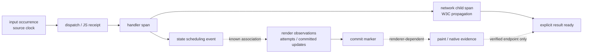

# Unified performance timeline

## Implemented run timeline increment (11 November 2026)

The Performance page now selects an archived run and trace explicitly, with a shareable `trace` URL parameter.
`GET /api/performance/runs/:id/traces` paginates the full captured trace index;
`GET /api/performance/runs/:id/traces/:traceId` verifies/replays the run and bounds detail to 2,000 spans / 16 MiB
of span JSON, with explicit total/truncation. This projection is separate from live trace retention.
`ui/src/lib/run-timeline.ts` subtracts exact source nanoseconds before converting relative offsets, traverses
parentage iteratively, keeps cyclic/orphan components visible and flags missing/duplicate/out-of-span observations.
The UI has real interval bars, zero-duration markers, selectable events (including coincident timestamps), and raw
resource/scope/link/attribute details. Profiler scalars remain on events. Source clock alignment is explicitly
unverified; no causal critical-path highlight is used in this run view. Legacy millisecond precision is labeled.

This is the initial tree/event projection. The track table and calibrated clock behavior below remain proposals;
metric overlays, native tracks, zoom/pan, virtual rows and build-aware source navigation remain open.

## Reuse the current viewer

Observer already lays out nested multi-service spans, details/events, operation self time and a critical-path highlight ([trace-page.tsx:25–155](../../../packages/next-observer/ui/src/pages/trace-page.tsx#L25), [waterfall.ts:31](../../../packages/next-observer/ui/src/lib/waterfall.ts#L31)). The geometry is runtime-neutral. Extend this viewer with a track projection and viewport; keep its existing tree mode. There is no demonstrated need to replace it.

Current limitations: events are details-only; no link/resource/scope inspector or metrics overlay; full-array recursive layout/full row rendering; critical path inferred from timestamps/parentage ([trace-page.tsx:248](../../../packages/next-observer/ui/src/pages/trace-page.tsx#L248), [trace-analysis.ts:60](../../../packages/next-observer/ui/src/lib/trace-analysis.ts#L60)). Its “spans that decided duration” copy is too strong for general async/cross-runtime experiments without dependency evidence. Existing self-time interval union is useful but is uncovered wall time, not CPU.

## Proposed interaction trace contract

A user interaction is a bounded operation with a declared start source and completion definition. Start at native/browser event occurrence only if that timestamp is available; otherwise name the endpoint JS-handler-start-to-completion. End with an application-specific result marker or independently observed presentation milestone. Timeout/cancel are terminal outcomes, not successful samples.

Solid ownership edges may justify parent-child spans; dashed associations require evidence and may be links, not parents. Diagram order is conceptual; operations overlap and can occur repeatedly.

Interaction root attributes: schema version, action, experiment identity, start.source, completion.kind, outcome. Synchronous handler/hooks get real interval spans; state scheduling and commit are events; Profiler render-work duration is a scalar on an event, not a fake contiguous interval. Render attempt id and commit id are optional trace metadata; unknown linkage stays unknown. Network child spans carry the actual HTTP conventions, not custom duplicate measurements. Native diagnostics retain source clocks/calibration.

## Correlation rules

- **Asynchronous work:** capture parent Context explicitly at scheduling time and pass it to continuations. Default browser synchronous context does not survive arbitrary awaits. Never leave a root globally active until completion; that would attach unrelated work.
- **Overlapping interactions:** allocate distinct interaction tokens. For shared work use one independently owned span with links to all participating roots; do not duplicate duration/sample counts. A React commit can be associated with multiple interactions or none.
- **Concurrent React / multiple commits:** separate attempts from committed update observations. Keep all known commits and mark the nominated completion commit separately; do not infer that last timestamp wins or that every render attempt commits.
- **Background work:** own roots/service tracks; show overlap but no causal edge unless explicitly linked.
- **Cancelled/superseded work:** record outcome and cancellation event, end once; pending children may finish independently. Report timeout/failure counts alongside success latency; don't silently drop them.
- **Presentation:** Event Timing can supply browser interaction timing; manual readiness is a separate metric. Browser rAF and RN layout/Profiler commit callbacks are proxies, not proof of physical pixel visibility. Native per-frame evidence may still lack identity tying a frame to the changed view.

## Track projection and display rules

Proposed track classification first uses explicit `observe.perf.track` and phase/source metadata, then standard span kind/network attributes, then a generic “other” fallback. Never require React-specific fields to display PHP/Go/Node work.

| Track | Representation | Controls/details |
|---|---|---|
| Interaction | Root interval, start/dispatch/complete/cancel milestones | Endpoint label, action/outcome, run identity, total observed latency |
| JS execution | Selected body/handler spans; scheduling-stall intervals separate | Source, wall versus CPU, timer interval, foreground status |
| React components | Timed invocation spans where genuinely available; Profiler render-work events/scalars grouped by commit | Attempt/commit distinction, phase, subtree/source, profiling build |
| Hooks | Selected compute/reducer/setup/cleanup spans | Inclusive/exclusive coverage, call count, source site, parent invocation |
| Network | Existing HTTP client/server spans across services | Actual parent/link, service, standard HTTP details |
| Native UI | Known render/mount/native interval spans; otherwise markers/unknown gaps | Source/platform/version; avoid inferring missing Fabric phases |
| Frames | Native frame intervals/anomalies; iOS cadence proxies separately styled | Deadline/refresh rate/source, aggregate versus per-frame evidence |
| Anomalies | Events/diagnostic spans with threshold | Measured time and detection/delivery time separately |
| Metrics | Time-window aggregates or gauge samples on an aligned panel | Unit/temporality/bucket interval/count; exemplar navigation |

Clock uncertainty: dashed interval edges or shaded uncertainty envelopes; tooltip reports domain, offset, uncertainty and calibration validity. Cross-service ordering within uncertainty is “ambiguous.” Native data without calibration is shown in a separate unaligned domain, not overlaid as exact. Metrics use bucket-width shading; no interpolation suggesting per-frame precision from a coarse aggregate. Trace/exemplar links are explicit, temporal overlays are labeled correlation.

Show interaction elapsed time as its own value. Work totals (hook/render/network) can overlap and are not a partition of total latency. Even exclusive wall times across threads/services may sum above elapsed time. The viewer must not calculate `hook + React + network + native = total`. Existing [timeByOperation.selfShare](../../../packages/next-observer/ui/src/lib/trace-analysis.ts#L84) already describes share of summed own time rather than trace duration; retain that distinction.

Critical path: keep the existing option for familiar trace trees but describe it as inferred. For interaction analysis only show a verified dependency path when input/scheduling/network/commit/completion edges are recorded. A late-ending native interval does not prove it delayed the interaction. Clock uncertainty, missing parents, sampled or evicted spans must downgrade confidence. General causal critical-path reconstruction is deferred.

## Incremental UI/backend changes

Proposed modules (not current):

1. Extend `src/collector/types.ts`, decoders and capture envelope for links, metadata and precise times; preserve existing millisecond projection. Add resources/scope/links to span details.
2. Add general attribute/resource predicates and run-aware queries. Proposed `GET /api/performance/timeline?runId&traceId&fromMs&toMs` returns spans/events/metric windows/calibrations/completeness; it is not an implemented route. Bound results with explicit truncation/cursor fields.
3. Add pure `ui/src/lib/performance-tracks.ts` projection and `components/performance-timeline.tsx`, using current waterfall geometry/selection and existing Panel/chart primitives. Keep trace tree as default for ordinary traces.
4. Add event timestamps, track filters, collapse, zoom/pan and virtual rows; show raw timing/source in details. Add source manifest lookup for selected hook; safe relative-path display first, build-aware source links later.
5. Add a compact comparison route using existing histogram and version-table styling; use run/variant selectors, completeness/source/unit and count, median/p75/p95. External reports remain the archival/statistical authority for the talk; UI should navigate evidence rather than duplicate a full statistics product.

Current `api.traces` requests 200 rows, storage defaults to 50, but a trace detail returns all spans ([api.ts:40](../../../packages/next-observer/ui/src/api.ts#L40), [memory-storage.ts:89–114](../../../packages/next-observer/src/collector/memory-storage.ts#L89)). Add total/truncation metadata; do not turn a silent page limit into a statistical sample. Layout must tolerate duplicate IDs, missing parents, cycles, zero durations, late batches and huge traces before adding dense hook tracks.

## Acceptance criteria

A fixture includes overlapping interactions, selected nested hooks, async network fan-in, two commits, unrelated background spans, cancelled work, native frame anomalies, metric windows, unknown render duration and clock uncertainty. The same data works in tree/track modes without changing totals. Hook selection reaches source metadata; generic non-React spans still render. Events have relative timestamps, links are navigable, unknown presentation is explicit. Missing/evicted data and approximate quantiles remain visible. Benchmark render/layout/query costs against declared capture sizes; set budgets from measurements, not guessed “large-trace support.”
