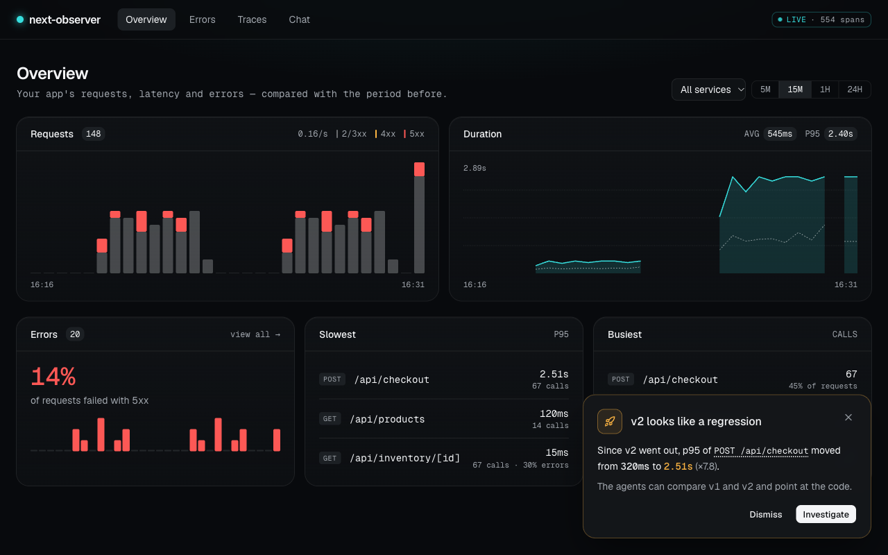

# next-observe

The **APM agent** for Next.js 16: a library inside your app that collects OpenTelemetry traces — server, browser and
your own code — and sends them out. Nothing else: no server, no UI, no AI in your app's dependencies.

To see the telemetry and have **AI agents** investigate it, run the observer next to the app:
**[next-observer](https://www.npmjs.com/package/next-observer)**.



## Two packages, one letter apart

| | [`next-observe`](https://www.npmjs.com/package/next-observe) | [`next-observer`](https://www.npmjs.com/package/next-observer) |
|---|---|---|
| **What it is** | the **APM agent** | the **observer** — a server with a UI and **AI agents** |
| **Where it runs** | inside your Next.js app (a dependency) | next to the app, started with `npx` (never a dependency) |
| **What it does** | collects telemetry and sends it | receives telemetry, shows it, investigates it |
| **Contains AI?** | no — OpenTelemetry only | yes — the AI agents live here |

```
 your Next.js app                          the observer
┌──────────────────────────┐              ┌──────────────────────────────────┐
│ next-observe             │    traces    │ next-observer        (port 4318) │
│ the APM agent            │ ───────────▶ │ server · UI · anomaly detector   │
│ collects and sends       │  OTLP/HTTP   │ AI agents that investigate       │
└──────────────────────────┘              └──────────────────────────────────┘
```

**Two kinds of "agent" — they are not the same thing:**

- **APM agent** = `next-observe`. The classic meaning from application performance monitoring: a library inside the app
  that records what happens (requests, timings, errors) and ships it out. It decides nothing.
- **AI agents** = inside `next-observer`. Language models with tools that query the recorded telemetry and answer
  "what is slow, since which deployment, and where in the code". They never run inside your app.

## What this package collects

- **Server** traces via `@vercel/otel`: every request, with route, duration and status
- **Browser** traces: document load, every request (`fetch` and `XMLHttpRequest`, so axios too), React renders
- **Browser errors**, each as a failed span the observer lists as a defect: uncaught exceptions, unhandled promise
  rejections, `console.error` (React reports errors caught by an `error.tsx` boundary there), images/scripts/styles
  that failed to load, a response that is not JSON where `res.json()` was called, requests that got no response at
  all, and **hydration mismatches** — in `next dev` with the component, the element and what the server and the client
  each rendered; in a production build React gives only a code, which is spelled out.
  `registerClient({ errors: false })` turns the error capture off.
- **Your own code** with a `'use observe'` directive: each call becomes a span with its file path, duration and errors
- Sent as OTLP/HTTP to the observer, to any other OpenTelemetry backend (Dynatrace, Tempo, …), or to both

> Reference implementation for the workshop *AI-Native Observability: Building Self-Debugging Next.js Applications with
> OpenTelemetry* (Porto, 2026).

## Quick start

Requires Node.js 22.18+ and Next.js 16. In the app folder:

```bash
npx next-observer init     # installs next-observe, wraps next.config, adds the instrumentation files and a script
npm run observe            # next dev + the observer: traces and the AI agents' chat at http://127.0.0.1:4318
```

`init` is safe to run again and never overwrites code it cannot merge — it tells you what to do by hand instead.

### By hand

```bash
npm install next-observe
```

```ts
// next.config.ts
import { withObserve } from 'next-observe/config'
export default withObserve({ /* your config */ })
```

```ts
// instrumentation.ts
export { register } from 'next-observe/server'
```

```ts
// instrumentation-client.ts
import 'next-observe/client'
```

```bash
npx next-observer dev          # observer + UI on http://127.0.0.1:4318, then `next dev`
```

Open http://127.0.0.1:4318 for traces and the chat with the AI agents.

## Instrument your own code

```ts
'use observe'                      // every exported function of this file gets a span

export async function chargePayment(amount: number) { … }
```

```ts
export async function loadData() {
  'use observe'                    // only this function
}
```

Spans carry `code.filepath`, so the AI agents can point at the file where the time went. Components get a `displayName` that
survives minification.

## Your own AI agents

The AI agents run in `next-observer`, not here, and so does their configuration: the built-in specialists and your own
ones in `observe.agents.ts` are set up for the observer, see the
[next-observer README](https://www.npmjs.com/package/next-observer). Nothing about them is imported into your app.
(Until 0.3 this package had `next-observe/agents` with the types for that file — the file is plain data now.)

## Configuration

| Variable | Default | |
|---|---|---|
| `OBSERVE_ENDPOINT` | `http://127.0.0.1:4318` | observer URL (set at `next build` time for production: the browser proxy is a rewrite) |
| `OBSERVE_SERVICE_NAME` | `name` from package.json | OTel `service.name` |
| `OBSERVE_SERVICE_VERSION` | `VERCEL_GIT_COMMIT_SHA` | OTel `service.version` — lets the AI agents compare deployments |
| `OBSERVE_API_KEY` | — | sent as `x-api-key`; the observer requires it when started with one |

### Sending to another OpenTelemetry backend

The server exporter also reads the standard OTel variables, so traces can go to any OTLP/HTTP backend:

| Variable | |
|---|---|
| `OTEL_EXPORTER_OTLP_ENDPOINT` | base URL, `/v1/traces` is appended |
| `OTEL_EXPORTER_OTLP_TRACES_ENDPOINT` | full traces URL, used as is |
| `OTEL_EXPORTER_OTLP_HEADERS`, `OTEL_EXPORTER_OTLP_TRACES_HEADERS` | `key=value,key2=value2` (percent-encoded), e.g. `Authorization=Bearer%20…` |
| `OTEL_EXPORTER_OTLP_PROTOCOL`, `OTEL_EXPORTER_OTLP_TRACES_PROTOCOL` | `http/json` (default) or `http/protobuf` |

Browser spans go to the app's own origin (`/__observe`) and are forwarded by the server. By default that is a rewrite whose
destination is fixed at `next build`. To read the destination and headers at **runtime** (and keep keys such as
`Authorization` on the server), add one file:

```ts
// app/api/next-observe/[...path]/route.ts   (or src/app/…)
export { POST } from 'next-observe/proxy'
```

`withObserve()` finds it and routes `/__observe/*` there; the route uses the same settings as `register()`.

**Several destinations.** `OBSERVE_*` describes the next-observer observer, `OTEL_EXPORTER_OTLP_*` your OTel backend. With
both set, every span goes to both, each with its own headers and protocol — the backend's `Authorization` never reaches
the observer and `x-api-key` never reaches the backend. Browser spans fan out the same way through the proxy route
(without it, the build-time rewrite reaches the observer only). Full control from code:

```ts
register({ destinations: [{ url: 'https://observer.example.com/v1/traces' }, { url: 'https://otlp.vendor.io/v1/traces', headers: { Authorization: 'Bearer …' }, protocol: 'http/protobuf' }] })
```

`register({ endpoint, tracesUrl, headers, apiKey, protocol })` configures the observer destination. The next-observer
observer accepts both `http/json` and `http/protobuf` (≥ 0.2.0).

Production React profiling: build with `next build --profile` to get component render timings.

## Explicit performance work

`next-observe/performance` provides an opt-in manual helper for selected synchronous callback bodies. It imports
only the OpenTelemetry API: no Next.js, DOM instrumentation, SDK initialization, React patching or automatic hook
transform. Configure OTel trace/metric providers in the application first, or inject a `tracer` and `meter`.
Next is an optional peer for this entry point; Next-specific entries still require a Next app.

```ts
import { createPerformanceProbe } from 'next-observe/performance'
const probe = createPerformanceProbe({
  mode: 'diagnostic',
  source: { file: 'src/Search.tsx', site: 'Search.useMemo/v1' },
  // tracer, meter: optionally inject configured SDK instruments without global registration
})
const action = probe.startInteraction('search.action')
// Carry this handle/context explicitly into the render/callback caused by this action.
const result = action.measureSync('computeResults', 'compute', () => computeResults(query))
// Call from the observed commit/completion callback, using its actual source:
action.event('react.commit', { source: 'react-profiler' })
action.end('committed')
```

Wrap the computation **inside** useMemo/reducer/custom-hook callbacks, rather than timing hook registration.
`measureSync` preserves returned values, promise and cleanup-function identity and thrown errors. It measures
only synchronous execution, without awaiting returned promises. Phases: `compute`, `reducer`, `effect.setup`,
`effect.cleanup`. Pass the handle/context explicitly across callbacks/awaits; unrelated actions start separate
root traces by default, without installing an async context manager. `end()` is idempotent; late callbacks run
without attribution. A measured callback can be an uncommitted attempt; only an actual commit observer should
mark its action as committed. No render-attempt/commit identity is inferred by this helper.

| Mode | Collection |
|---|---|
| `disabled` | Calls work directly; no instrument/provider lookup, timestamps or spans from the helper |
| `diagnostic` | Interaction spans/events, selected work spans, work/interaction histograms |
| `production_like` | Interaction spans/events and histograms; omits per-work spans |

Metric names `observe.perf.work.duration` and `observe.perf.interaction.duration` use seconds. Selected work
histograms bound the callback with monotonic clock calls; work span elapsed includes additional probe/SDK cost.
Profiler render work may overlap these values and must not be added to them. Caller-declared completion is
not automatically paint, INP or native presentation. Source names/sites must be static and low-cardinality;
run/variant/build identity usually belongs on the SDK resource. Configure bounded SDK queues/export policy in
the application. These modes are collection controls, not measured overhead guarantees. The standalone React
experiment lives in the sibling `performance-observability` repo; RN bootstrap/native measurement remains to
be validated separately. Existing client/server/directive behavior is unchanged.

## Entry points

| Import | For |
|---|---|
| `next-observe/performance` | explicit manual selected-work timing; app-owned OTel bootstrap |
| `next-observe/config` | `withObserve()` for `next.config.ts` |
| `next-observe/server` | `register()` for `instrumentation.ts` |
| `next-observe/client` | browser telemetry for `instrumentation-client.ts` |
| `next-observe/proxy` | runtime proxy route for browser spans (optional) |

Traces are sent as OTLP/HTTP — JSON by default, protobuf with `protocol: 'http/protobuf'` / `OTEL_EXPORTER_OTLP_PROTOCOL`.

## License

MIT
