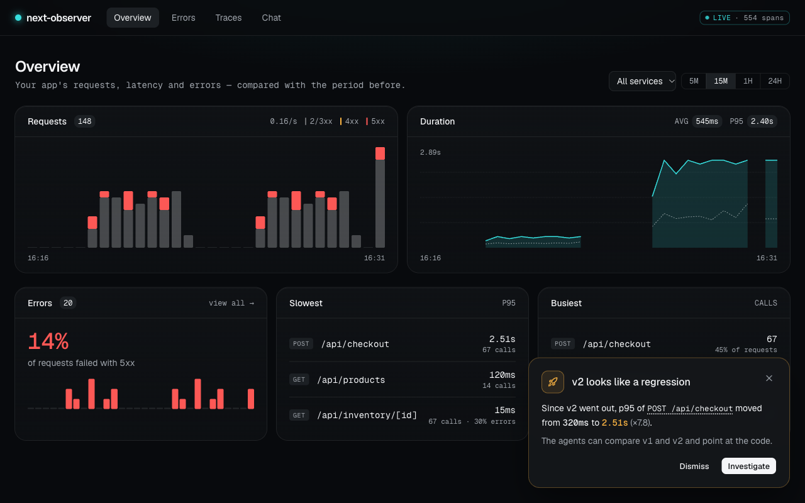
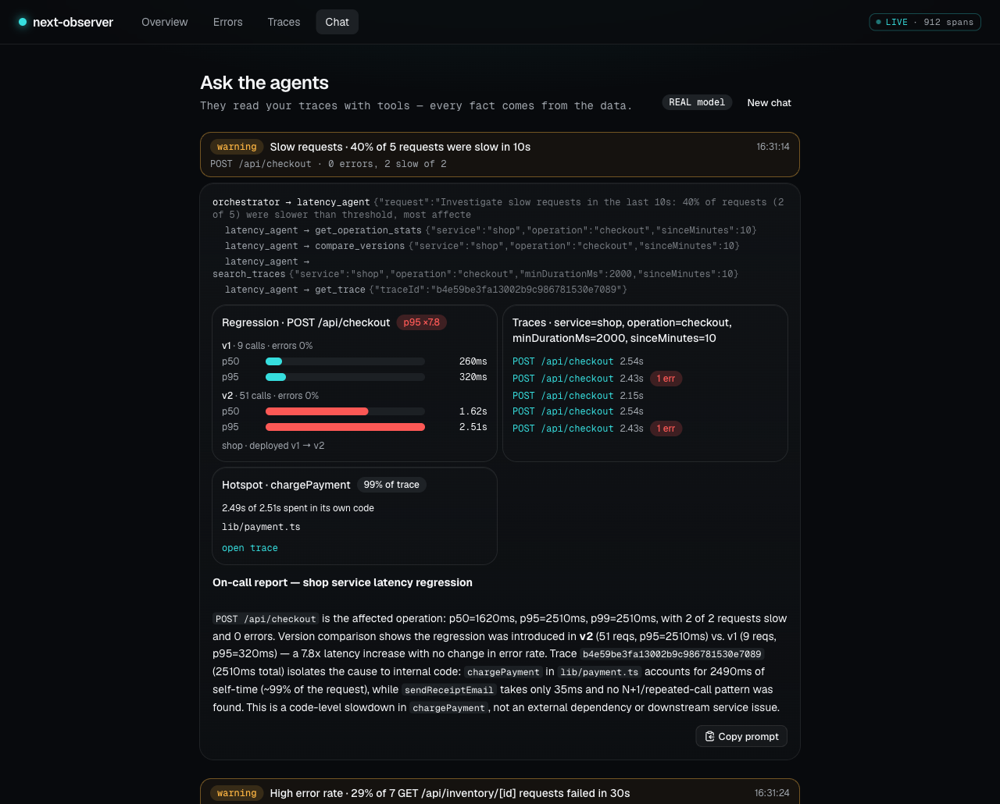
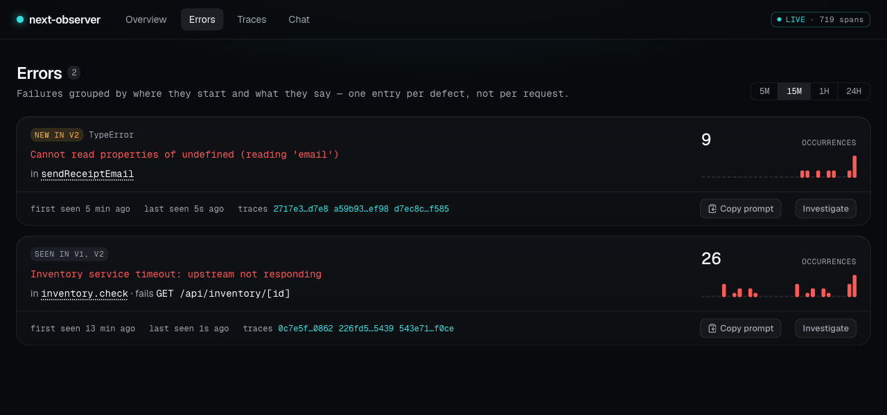
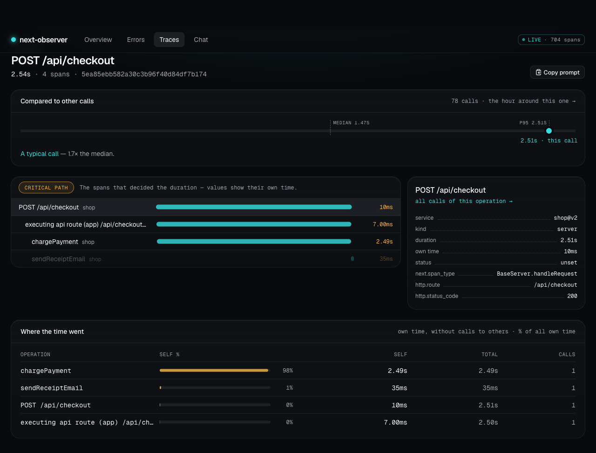
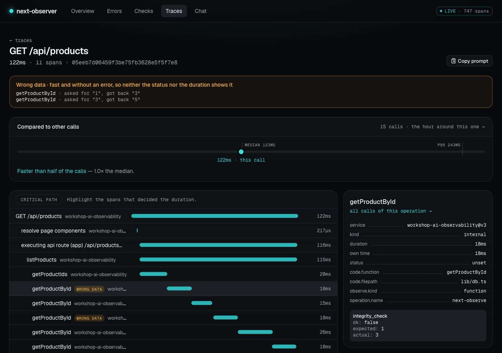
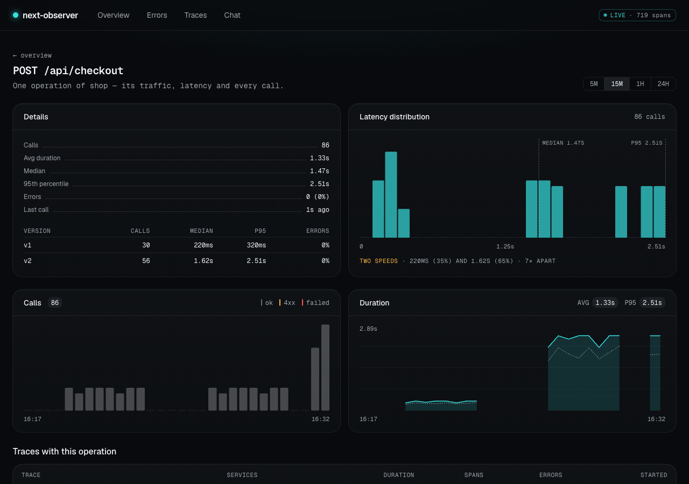
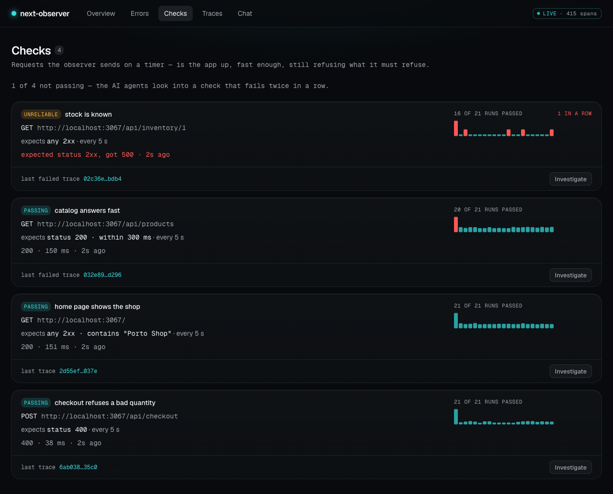

# next-observer

The **observer** for Next.js: one process that receives your app's telemetry, shows it, and has **AI agents** investigate
it. A server, a UI, an anomaly detector and the agents — started with `npx`, never installed into your app.

```bash
npx next-observer init     # once: connects the app (installs the APM agent, next-observe, into it)
npm run observe            # the observer + `next dev`; open http://127.0.0.1:4318
```

No app at hand? `npx next-observer collector --demo` starts the observer with a sample shop that has four things to
find: a deployment that made checkout slower, a failing endpoint, an N+1 query, and an error the last deployment brought.



## Two packages, one letter apart

| | [`next-observe`](https://www.npmjs.com/package/next-observe) | [`next-observer`](https://www.npmjs.com/package/next-observer) |
|---|---|---|
| **What it is** | the **APM agent** | the **observer** — a server with a UI and **AI agents** |
| **Where it runs** | inside your Next.js app (a dependency) | next to the app, started with `npx` (never a dependency) |
| **What it does** | collects telemetry and sends it | receives telemetry, shows it, investigates it |
| **Contains AI?** | no — OpenTelemetry only | yes — the AI agents live here |

```
 your Next.js app                          the observer
┌──────────────────────────┐              ┌──────────────────────────────────┐
│ next-observe             │    traces    │ next-observer        (port 4318) │
│ the APM agent            │ ───────────▶ │ server · UI · anomaly detector   │
│ collects and sends       │  OTLP/HTTP   │ AI agents that investigate       │
└──────────────────────────┘              └──────────────────────────────────┘
```

**Two kinds of "agent" — they are not the same thing:**

- **APM agent** = `next-observe`. The classic meaning from application performance monitoring: a library inside the app
  that records what happens (requests, timings, errors) and ships it out. It decides nothing.
- **AI agents** = inside `next-observer`. Language models with tools that query the recorded telemetry and answer
  "what is slow, since which deployment, and where in the code". They never run inside your app.

## What you get

**Overview** — requests by status class, latency and 5xx rate, each compared with the period before; the slowest and
the busiest routes. When the latest deployment made a route slower or more error-prone, a banner says so with the
measured numbers, and **Investigate** hands the question to the AI agents.

**AI agents that investigate — asked or on their own.** The anomaly detector watches incoming traces; when errors or
latency jump it starts an investigation by itself. The agents get facts only from tools over your telemetry, and the
evidence cards under a report are built by code from those tool results, not written by the model.



**Errors as defects** — one entry per "this operation fails with this message", not per failed request: where the
error originated, which requests fail because of it, when it was first seen, and whether the last deployment brought it.



**Traces** — a waterfall, the critical path (the spans that decided the duration), each operation's own time, and how
this call compares with the others of its kind.



A span can be fast, without an error, and still carry the wrong answer. When the app records its own verdict as a span
event — `integrity_check` with `ok`, `expected`, `actual` — the observer raises an anomaly on the first `ok: false` and the
trace says so. The AI agents get those checks counted per deployed version (`compare_versions`), so they can name the
version that started returning wrong data and how often it happens:



**One operation up close** — its latency distribution, and a note when the calls fall into two clearly separate speeds
(a fast and a slow path, or the version before and after a deployment).



**Copy prompt** — on a trace, a defect or a finished investigation: a ready prompt for a coding agent (Claude Code,
Cursor, …) with the measured facts and the task, so the fix starts from data instead of a retelling.

Also: cold starts are not regressions (the first request of a route after a server start is left out of latency and
marked), no Docker and no external backend, and it accepts OTLP/HTTP from any OpenTelemetry SDK — not only `next-observe`.

Requires Node.js 22.18+.

## OTLP trace ingestion

The backend receiver accepts `POST /v1/traces` as OTLP/HTTP JSON or protobuf, optionally gzip-compressed.
The existing span/query fields remain available. Decoded spans also expose `startTimeUnixNano` / `endTimeUnixNano`
as exact decimal strings, normalized `links`, and an `otlp` object (`schemaVersion: 1`) containing supported typed
source fields: attributes (including int64/bytes), resource/scope/schema metadata, flags, trace state, events, links
and dropped counts. Integers outside JavaScript's safe range are strings in the display attribute projection too.
This supported-field representation is not a byte-for-byte archive: unknown protobuf/JSON fields are not retained.

Invalid trace batches are rejected atomically with HTTP 400 before insertion. Empty OTLP requests remain valid.
Failures return OTLP Status code/message in the request encoding; JSON also retains the legacy `error` property.
Defaults are 10 MiB before/after decompression, 10,000 spans, nesting depth 32 and 250,000 decoded values/wire fields.
Programmatic `startCollector({ traceLimits: { maxSpans, maxDepth, maxValues } })` adjusts the decoded limits.
Counts/depth apply independently; a request can hit the value limit before its span-count limit.

MemoryStorage deduplicates `(traceId, spanId)` atomically: the first accepted observation wins while retained.
Retries do not inflate stats or detector input. Eviction removes the dedup identity, so replay after eviction can be
accepted again. Custom storage adapters can implement optional `insertSpansOnce()` to provide the same contract;
legacy `insertSpans()` adapters remain supported and own their deduplication/detector-input behavior.

`GET /api/traces/:id` adds `completeness.historyComplete` (false after any storage eviction) and
`completeness.missingParentCount` (parents absent from currently stored spans). Neither proves all spans arrived.
Storage is still volatile; durable capture/replay is a separate upcoming change.

## OTLP metrics ingestion

`POST /v1/metrics` accepts JSON/protobuf and gzip with the same transport/auth/body limits as traces.
Supported types are Sum (Counter/UpDownCounter), Gauge and explicit Histogram. Delta/cumulative temporality,
monotonicity, resource/scope/schema metadata, point attributes, flags, exemplars and exact int64/timestamps are
preserved. ExponentialHistogram and Summary are rejected with HTTP 400; they are not silently acknowledged.
Invalid or conflicting batches are rejected atomically. Point limits are configurable through `metricLimits`
(`maxPoints`: 10,000, `maxDepth`: 32, `maxValues`: 250,000 by default).

A separate `MemoryMetricStorage` retains 100,000 raw points by insertion order by default; the span-only
`StorageAdapter` stays unchanged. Use `startCollector({ metricStorage })` for another metric adapter or `false`
to disable metrics (ingest/query then return 503). Identical retained stream/interval retries are idempotent;
conflicting values or source details return 400. Identity includes resource/scope, metric name/unit/type,
temporality/monotonicity, point attributes and start/end timestamps. Dedup expires with eviction/restart.

- `GET /api/performance/capabilities`: enabled signals/types.
- `GET /api/performance/metrics?name&service&fromMs&toMs&limit&offset`: typed points, `total`, `truncated`,
  `nextOffset` and `historyComplete`. Page limit defaults to 100 (maximum 1,000). The default raw-record page
  budget is 16 MiB; follow `nextOffset` even when a page contains fewer than `limit` points. Configurable via
  `new MemoryMetricStorage(maxPoints, maxQueryBytes)`. A single oversized record fails explicitly.

These queries use the same UI Basic auth protection as trace queries; ingest retains x-api-key auth.
Cumulative checkpoints, reset epochs, out-of-order points and changed bucket schemas remain separate records;
there is no automatic differencing, rate calculation, cross-point merge or averaging of percentiles.
Per-point histogram p50/p75/p90/p95/p99 are **approximate**, with bucket lower/upper bounds and the interpolation
method named in the response. Unbounded buckets without observed min/max have a null estimate; empty,
aggregate-only or no-recorded-value populations have no quantiles. This is not exact sample percentile data.
Metric collection in Observe, experiment run partitions/capture and metric visualization are subsequent work.

## Commands

```bash
next-observer init [--root <dir>] [--proxy]                          # connect a Next.js app (see below)
next-observer dev [--root <dir>] [--port <n>] [-- <next dev args>]   # the observer + your app's `next dev`
next-observer collector [--host <h>] [--port <n>] [--api-key <k>] [--ui-password <p>] [--demo]   # the observer alone
```

Run them with `npx next-observer <command>`; installed globally (`npm i -g next-observer`) the command is also
available as `nxo`.

`next-observer init` installs the APM agent, `next-observe`, with the project's package manager, wraps the exported `next.config` in
`withObserve()`, creates `instrumentation.ts` and `instrumentation-client.ts` (in `src/` when the app lives there; `.js`
without TypeScript) and adds an `observe` script. Already connected files stay untouched; an existing `register()` is
never rewritten — init says what to add. `--proxy` also creates the runtime proxy route for browser spans.

`next-observer dev` is a convenience for local work: it starts the observer and then your app's own `next dev` in the
same terminal. The app stays yours — the observer only launches it.

`next-observer collector` runs the observer alone — next to `next dev` in another terminal, or on a server for
production. ("Collector" is the OpenTelemetry word for the server that receives telemetry; here it comes with the UI,
the detector and the AI agents.) `--demo` preloads the sample shop and keeps sending live traffic, so the detector and
the AI agents have something to find without an app.

## On a server

The observer started with `--host 0.0.0.0` is reachable from outside — protect both doors:

```bash
next-observer collector --host 0.0.0.0 --api-key <ingest key> --ui-password <password>
```

`--api-key` is for the apps sending traces (`OBSERVE_API_KEY` in the app), `--ui-password` for the people opening the
UI and the chat (the browser asks for it). `/health` stays open for uptime checks. Without them the banner warns.

## Models for the AI agents

| `OBSERVE_AI` | Model |
|---|---|
| `mock` (default) | deterministic stand-in — the whole pipeline runs without a model, tokens or a network |
| `real` | Gemini when `GEMINI_API_KEY` + `GEMINI_MODEL` are set, otherwise [Kitana](https://www.npmjs.com/package/@kitana-sdk/adk) (Claude / Codex CLI, Ollama, API keys) |

One investigation makes 7–12 model calls. A call that hangs is started again once; "too many requests" (429) and
"overloaded" (5xx) are waited for and retried — up to a minute, as the provider asks. A free Gemini tier allows only a
few requests per minute, so an investigation may pause for that minute; a key without credits, a wrong key or a wrong
model name is explained in the chat in plain words.

The chat keeps a list of investigations — your questions and the ones the observer started on its own — with their
state; pick one to read it again. The observer keeps them (the last 100, in memory), so a reload or another browser
shows the same list; a restart of the observer starts clean.

An investigation can be stopped — the **Stop** button next to "working…" in the chat, for a question you asked and for
one the observer started on its own. What was found until then stays on the page. A model behind an API drops the call
in flight; a CLI model finishes the call it is on and then stops. A stopped (or timed-out) conversation is not continued —
the next question starts a new one.

## Your own AI agents

The built-in AI agents are an orchestrator and three specialists (latency, errors, traffic). To change them, put `observe.agents.ts` (or `.mts`, `.js`, `.mjs`) in the app root. A specialist with a built-in name
(`latency_agent`, `error_agent`, `traffic_agent`) replaces it; a new name adds one. The orchestrator picks specialists by
their `description`; the rules "facts from tools only" and "own tools only" are added to every instruction.

```ts
type Specialist = { name: string; description: string; instruction: string; tools: string[] }

const specialists: Specialist[] = [
  {
    name: 'latency_agent',
    description: 'Finds slow operations and the deployment that made them slow',
    instruction: 'First call compare_versions; then open one slow trace and name the span with the highest selfMs.',
    tools: ['compare_versions', 'search_traces', 'get_trace'],
  },
]

export default specialists
```

The file is plain data — no imports, like `observe.checks.ts` below; the type in it is only there for your editor.
Tools: `get_services`, `get_operation_stats`, `compare_versions`, `get_errors`, `search_traces`, `get_trace`.
`next-observer` validates the file and lists the loaded specialists on start. It also watches the app root: create or
change `observe.agents.*` (or `observe.checks.*`, below) while it runs and it reloads the file — no restart, so the
telemetry you already have stays. A file that does not load keeps what was running, with a line saying why. Only that
one file is reloaded (not modules it imports); reloaded agents start new chat conversations, reloaded checks start
with a fresh history.

## Scheduled checks

Put `observe.checks.ts` (or `.mts`, `.js`, `.mjs`) in the app root to have the observer ask the app on a timer: is it
up, is it fast enough, does it still refuse what it must refuse. The file is plain data — no imports:

```ts
export default [
  { name: 'catalog answers fast', url: '/api/products', expect: { status: 200, maxMs: 300 } },
  { name: 'home page shows the shop', url: '/', expect: { bodyIncludes: 'Porto Shop' } },
  { name: 'guests cannot see orders', url: '/api/orders', expect: { status: [401, 403] } },
  { name: 'checkout refuses a bad quantity', url: '/api/checkout', method: 'POST', body: { quantity: 99 }, expect: { status: 400 } },
]
```

| Field | Default | |
|---|---|---|
| `name` | — | unique in the file |
| `url` | — | a path (sent to the app) or a full `http(s)` URL |
| `method`, `headers`, `body` | `GET` | a `body` that is not a string is sent as JSON |
| `everySeconds` | `60` | at least 5 |
| `timeoutMs` | `10000` | no answer within it is a failure |
| `expect.status` | any 2xx | one status or a list; redirects are not followed — a 302 is an answer |
| `expect.maxMs` | — | the whole answer, body included |
| `expect.bodyIncludes` | — | text the body must contain |

Paths go to `OBSERVE_APP_URL`; without it, to the host and port `next dev` was given (`-H`, `-p`, `PORT`), else
`http://localhost:3000`. That is a guess: when the port is busy, `next dev` moves to the next free one — compare the
address in the observer's banner with the one Next prints, and set `OBSERVE_APP_URL` if they differ.

- Every request carries the header `x-observe-check` (the check's name, URL-encoded) and a trace id of its own, so each
  result links to the trace the app recorded for it.
- These requests are not traffic for the anomaly detector: an expected refusal is not an error, and a quiet app stays quiet.
- While the app is still starting (it has not answered yet, first minute), a refused connection is not a failure — the
  check is tried again every 5 s.
- A body is read only when `maxMs` or `bodyIncludes` asks about it, and then its first megabyte; an event stream is
  never read. So the status of a streaming route can be checked.
- A field that is misspelled, or an expectation that can never hold (a body text on `HEAD`), is an error on start.

Results: the **Checks** page — every check with its state, the last answer, a bar per run and a link to the trace of the
last failed request — and `GET /api/checks` (the last 50 runs per check and how many failed in a row).



**When a check keeps failing, the AI agents look into it on their own** — the same way as with an anomaly in real
traffic: it appears in the chat, and the investigation starts from the trace of the failing request.

- twice in a row → `critical` (it is down now);
- 3 of the last 10 runs → `warning` (it is unreliable — a check failing every third time never fails twice in a row);
- an app that is down is **one** anomaly naming every check that cannot reach it — not one investigation per check;
- one failure is not an anomaly: the first answer after a restart is often just slow;
- after an anomaly the same check — and, when nothing accepted the connection, the same address — is quiet for
  5 minutes, whatever happens meanwhile; `OBSERVE_DETECTOR=off` switches this off too.

**The agents start at most 5 investigations on their own per 60 minutes** (`OBSERVE_AUTO_INVESTIGATIONS`), and at most
2 wait behind the running one: an investigation an hour after its anomaly is no use, and a real model left running
overnight must not spend a subscription. An anomaly over the budget still appears in the chat, marked as not
investigated. Questions you ask are not counted. `GET /api/chat` shows how much is used, per incident type.

## Configuration

| Variable | Default | |
|---|---|---|
| `OBSERVE_AI` | `mock` | `mock` \| `real` |
| `OBSERVE_DETECTOR` | on | `off` disables the anomaly detector |
| `OBSERVE_AUTO_INVESTIGATIONS` | `5/60m` | investigations the agents start on their own per period: `5`, `5/30m`, `5/2h`; `0` = only when asked |
| `OBSERVE_APP_URL` | `http://localhost:3000` | where the checks from `observe.checks.ts` are sent |
| `OBSERVE_MODEL_TIMEOUT_MS` | `90000` | how long one model call may take before it is started again |
| `OBSERVE_API_KEY` | — | require `x-api-key` on ingest (`/v1/traces`) |
| `OBSERVE_CAPTURE_DIR` | — | opt-in local run capture directory (`--capture-dir`) |
| `OBSERVE_UI_PASSWORD` | — | require a password for the UI, the query API and the chat (browser login, any user name) |
| `OBSERVE_PORT`, `OBSERVE_HOST`, `OBSERVE_ROOT` | `4318`, `127.0.0.1`, `.` | same as `--port`, `--host`, `--root` |

Accepts OTLP/HTTP traces from any OpenTelemetry SDK or Collector: `application/json` and `application/x-protobuf`,
optionally `Content-Encoding: gzip`, on `/v1/traces`.

## Experiment run archives

Enable local capture with `next-observer collector --capture-dir ./captures` (or `OBSERVE_CAPTURE_DIR`).
Create a run before configuring its exporters:

```sh
curl -X POST http://localhost:4318/api/performance/runs \
  -H 'Content-Type: application/json' \
  -d '{"runId":"hook-baseline-01","metadata":{"experiment":"C","variant":"baseline","platform":"react-web","sources":[{"name":"manual-hook","available":true}],"clocks":[{"source":"performance","uncertaintyNs":null}]}}'
```

Send OTLP traces/metrics to the usual endpoints with exporter header `x-observe-run-id: hook-baseline-01`.
The header selects one partition for the entire request; use a separate exporter/batch per run. It is authoritative;
metadata and telemetry attributes are preserved without rewriting them. Run IDs are case-sensitive. Unknown runs
are rejected; tagged ingest with capture disabled returns 503. Tagged requests go exclusively to the archive,
independently of live memory retention and the live anomaly detector. The current UI/legacy trace routes display
live data; run visualization is a subsequent step. Existing untagged ingest remains the live path.

Run management/query uses the configured UI Basic auth; OTLP ingest uses `x-api-key` when configured.

| Endpoint | Result |
|---|---|
| `POST /api/performance/runs` | Create `{runId, metadata}`; existing IDs return 409 |
| `GET /api/performance/runs` | Run headers/counts, without per-request inventories; at most 100 runs per directory listing |
| `GET /api/performance/runs/:id` | Versioned manifest, exact raw request hashes/inventory and deduplicated span/point counts |
| `GET /api/performance/runs/:id/spans` | Raw normalized observations, `total`, `truncated`, `nextOffset`, run header |
| `GET /api/performance/runs/:id/metrics` | Typed metric observations with the same pagination contract |
| `POST /api/performance/runs/:id/finalize` | Atomically publish the frozen manifest; repeated finalization returns the same manifest |

Both observation endpoints accept `limit` (1–1000, default 100), `offset` (default 0), and JSON-encoded `where`:
`[{"target":"resource","key":"service.name","value":{"stringValue":"my-app"}},
{"target":"observation","key":"observe.perf.phase","value":{"stringValue":"compute"}}]`.
All equality conditions apply to **one span or point**. Resource and observation attributes are separate; int64
predicates use `intValue` decimal strings and never coerce to a number. At most 16 predicates are allowed, using
`RUN_ATTRIBUTE_ALLOWLIST` exported from `next-observer/collector`. Queries have a 16 MiB observation-page budget;
follow `nextOffset` rather than assuming `limit` observations were returned. Pages are stable for finalized runs;
active runs may change. Trace-list responses are never used to assemble an experiment dataset.

The `next-observe/run/v1` directory holds `run.json`, numbered original **decompressed OTLP request bytes**
(`json`/`protobuf`), and an atomically published `finalized.json`. Thus unknown JSON/protobuf fields survive in the
archive even though current decoders only project supported fields. Gzip transport bytes/HTTP credentials are
not archived. Each request is validated and conflict-checked before file publication; file and parent directory
are synced before success. Exact raw request retries are idempotent; JSON/protobuf equivalents may have separate
files but are deduplicated on replay. Trace identity uses traceId/spanId (first observation wins); metric identity
uses typed resource/scope/stream/interval, with conflicting values rejected. Keys are derived from the archived
OTLP fields using these same storage rules. No cumulative differencing or cross-run aggregation is performed.

`finalized` means the accepted archive is frozen and integrity-checked. `coverage: received-requests-only` does
not assert that the producer exported every observation. Record known producer/harness omissions in metadata
`incompleteReasons`. Source availability, clock/calibration records and external artifact `{name, sha256,
sizeBytes, mediaType?}` references stay in metadata; they are declarations, not measurements fabricated by the
receiver. External artifact bodies remain separate; callers can verify a body with `hashArtifact()`.

```js
import { RunCapture, replayRun, hashArtifact } from 'next-observer/collector'
const capture = new RunCapture('./captures')
// Record await hashArtifact('./lighthouse.json', 'application/json') in metadata when creating the run.
await capture.finalize('hook-baseline-01')
await capture.exportRun('hook-baseline-01', './frozen-hook-baseline-01') // new destination directory
const { manifest, storage, metricStorage } = await replayRun('./frozen-hook-baseline-01')
// Fresh isolated stores on every replay; no insertion into another run or live storage.
```

Replay checks schema, sequence, hashes, counts and final inventory, and fails on incompatible versions or
corruption. Without the final marker it reports `incomplete` and ignores unpublished `.pending-*` files.
Concurrent operations are serialized per run; a filesystem lock rejects a second process writer with 503.
After a crash, standalone `replayRun()` can inspect an incomplete run without writing. Check that no writer
is alive before removing a stale `.write-lock` to resume writes. Never edit finalized captures.

Defaults per run: 64 MiB uncompressed requests, 10,000 distinct raw requests, 200,000 decoded observations
(including non-identical retries); 10 MiB per request. `RunCapture(directory, options)` and `replayRun(directory,
options)` enforce these budgets. Raw bodies are read with bounded streams; each request still has the standard
trace/metric decoder limits. Metadata is bounded by 64 KiB/depth 16. For this local experiment MVP, each append/query
replays the run for validation; it is intended for bounded captures, with no throughput or fleet-scale claim.
Capacity/latency measurements and indexed storage remain future work. No dependencies or instrumentation APIs
were added for capture.

## Performance run viewer and external comparisons

The **Performance** page (`/performance`) lists captured runs, filters variant/collection mode and opens a run's
source/clock/build metadata, paginated spans/events/links and typed metric points. It uses the explicit run archive
APIs, independently of live trace storage. Finalized means frozen received requests; completeness and producer
omissions remain visible. Empty OTLP captures are not shown as zero-duration measurements.

External analysis stays in the experiment harness. To display its validated summary, publish the generic
`observe.performance-report/v1` artifact into a separate report directory, then start:

```sh
next-observer collector --capture-dir ./session/captures --performance-report-dir ./observer-reports
```

`OBSERVE_PERFORMANCE_REPORT_DIR` is the equivalent environment variable; capture must be enabled. The Performance
page requires explicit report selection, with links to its exact run IDs. It shows median-of-run-medians, run median
ranges, measured action counts, warmup exclusions and declared endpoint/method/limitations. External samples can
therefore be shown for disabled runs with no OTLP points. Raw spans/metric populations retain warmup; they are not
presented as the post-warmup statistical sample. Cumulative metric checkpoints remain separate; per-point histogram
estimates are marked approximate and use the source unit. Reports are hidden if a refresh fails verification.

`PerformanceReports(directory, capture)` reads `<id>.json` and hash-addressed `artifacts/<sha256>` files. Its contract
is exported as `PerformanceReport`: report ID/title, endpoint, analysis unit/algorithm, protocol reference, per-run
sample summaries/artifact and manifest hashes, explicit group membership, externally calculated group summaries,
and limitations. It validates schema/finite values/quantile ordering/unique membership, protocol/sample hashes,
finalized manifest hashes, raw OTLP replay integrity, variant/mode and protocol association. It checks artifact
integrity and association, not statistical correctness or authenticity of an untrusted analysis producer. No external
code/HTML is executed. UI types are browser-safe contracts checked against the backend schemas.

API (same UI Basic auth as other query routes):

- `GET /api/performance/features`: `{runs, reports}`.
- `GET /api/performance/reports`: report headers plus explicit errors for invalid reports.
- `GET /api/performance/reports/:id`: verified typed report; disabled returns 503.

Limits: 100 report files per directory listing, 500 runs/100 groups per report, 8 MiB per report/artifact read,
64 MiB external artifact bytes per report. Capture replay retains its own bounds. This local MVP revalidates files on
read; no query-throughput claim or persisted statistical database is implied. Existing trace/metric/auth contracts
remain compatible. Run-specific track visualization and rich histogram/exemplar navigation remain subsequent work.

The sibling experiment repo supplies `npm run observer-report -- <session> <output-directory>` to adapt its frozen
comparison to this contract. Use the decoder build pinned by that session when exporting; changing the Observer
backend changes its source fingerprint, so the original harness can intentionally refuse re-analysis with a new
build. The viewer consumes the resulting artifact and verifies the archived OTLP using its versioned archive schema.

## Entry points

| Import | For |
|---|---|
| `next-observer/collector` | `startCollector()`, storage, OTLP/JSON decoding |
| `next-observer/debug` | agent tools as plain functions, `AnomalyDetector`, demo data |
| `next-observer/agents` | ADK agents, chat handler, built-in specialists |

## License

MIT
